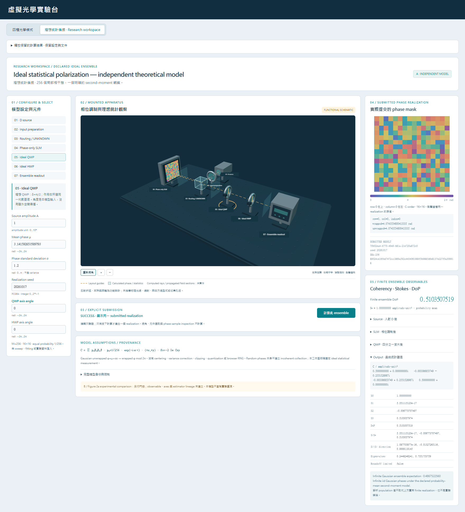
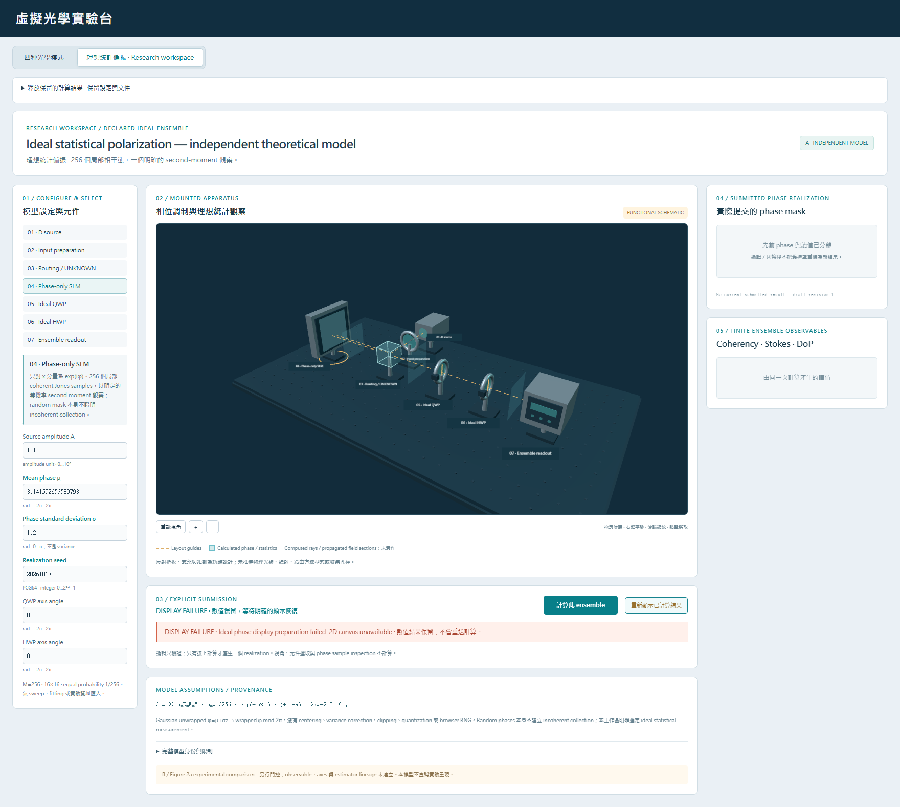

# A verification and evidence — 2026-10-17

This is the precommit implementation record for **Ideal statistical
polarization — independent theoretical model**. All captures below are current
A work, separate from unchanged historical readiness/semantics and V2g records.
No experimental Figure2a accuracy claim is included. Publication remains subject
to the clean-postcommit gate specified below and its fresh ignored closeout.

## Scope and environment

Opening clean synchronized main and live remote:
`2b3046682b0b5aefc4e712b901393209a9cede7e`. The existing interpreter is
`C:\holographiclab\.venv\Scripts\python.exe`, Python3.11.9/NumPy2.4.6.
Installed frontend tools use Node24 and installed Chrome155.0.8059.82.
No dependency/browser installation, package upgrade, lockfile/global configuration
change, branch switch, stash, reset or history rewrite occurs.

Fresh ignored owned evidence root: `runs/r03_ideal_polarization_impl_01/`.
Ownership/absence/ignore checks preceded creation. The unchanged inventory source
is `runs/r03_fig2a_semantics_01/implementation_split.md`, SHA256
`83ab9f5c310dbcbc1401cc3de3b8cde9df4d87cefeb1a2af38deb591e3670f9e`.
`scope.json` freezes all41 unique repository-contained Windows identities,
10modifications/31creations, before executable work. The opening model contract
SHA256 is `e3310a45c9960bd50dc15b973cac0ab623caa7a0f99585e911a983f8717077e2`.
It remains unchanged. Public RNG-constructor equivalence and the retained modulo
roundoff endpoint are explicit implementation clarifications, not a new model.

## Baseline and restored final Python suite

Exact child command from the repository root for both runs:

```powershell
C:\holographiclab\.venv\Scripts\python.exe -B -m pytest -q -p no:cacheprovider
```

Baseline unedited stdout (`inspection/baseline_python.stdout.txt`):

```text
........................................................................ [  2%]
........................................................................ [  4%]
........................................................................ [  6%]
........................................................................ [  8%]
........................................................................ [ 11%]
........................................................................ [ 13%]
........................................................................ [ 15%]
........................................................................ [ 17%]
........................................................................ [ 19%]
........................................................................ [ 22%]
........................................................................ [ 24%]
........................................................................ [ 26%]
........................................................................ [ 28%]
........................................................................ [ 31%]
........................................................................ [ 33%]
........................................................................ [ 35%]
........................................................................ [ 37%]
........................................................................ [ 39%]
........................................................................ [ 42%]
........................................................................ [ 44%]
........................................................................ [ 46%]
........................................................................ [ 48%]
........................................................................ [ 51%]
........................................................................ [ 53%]
........................................................................ [ 55%]
........................................................................ [ 57%]
.....s.................................................................. [ 59%]
........................................................................ [ 62%]
........................................................................ [ 64%]
........................................................................ [ 66%]
........................................................................ [ 68%]
........................................................................ [ 71%]
........................................................................ [ 73%]
........................................................................ [ 75%]
........................................................................ [ 77%]
........................................................................ [ 79%]
........................................................................ [ 82%]
........................................................................ [ 84%]
........................................................................ [ 86%]
........................................................................ [ 88%]
........................................................................ [ 91%]
........................................................................ [ 93%]
........................................................................ [ 95%]
........................................................................ [ 97%]
........................................................................ [ 99%]
...                                                                      [100%]
=========================== short test summary info ===========================
SKIPPED [1] tests\test_run_artifacts.py:1101: this Windows account lacks symlink privilege; junction is tested separately
3242 passed, 1 skipped in 140.63s (0:02:20)
```

Restored final unedited stdout (`inspection/final_python_02.stdout.txt`):

```text
........................................................................ [  2%]
........................................................................ [  4%]
........................................................................ [  6%]
........................................................................ [  8%]
........................................................................ [ 10%]
........................................................................ [ 12%]
........................................................................ [ 14%]
........................................................................ [ 16%]
........................................................................ [ 18%]
........................................................................ [ 20%]
........................................................................ [ 22%]
........................................................................ [ 25%]
........................................................................ [ 27%]
........................................................................ [ 29%]
........................................................................ [ 31%]
........................................................................ [ 33%]
........................................................................ [ 35%]
........................................................................ [ 37%]
........................................................................ [ 39%]
........................................................................ [ 41%]
........................................................................ [ 43%]
........................................................................ [ 45%]
........................................................................ [ 48%]
........................................................................ [ 50%]
........................................................................ [ 52%]
........................................................................ [ 54%]
........................................................................ [ 56%]
..................................s..................................... [ 58%]
........................................................................ [ 60%]
........................................................................ [ 62%]
........................................................................ [ 64%]
........................................................................ [ 66%]
........................................................................ [ 68%]
........................................................................ [ 70%]
........................................................................ [ 73%]
........................................................................ [ 75%]
........................................................................ [ 77%]
........................................................................ [ 79%]
........................................................................ [ 81%]
........................................................................ [ 83%]
........................................................................ [ 85%]
........................................................................ [ 87%]
........................................................................ [ 89%]
........................................................................ [ 91%]
........................................................................ [ 93%]
........................................................................ [ 96%]
........................................................................ [ 98%]
................................................................         [100%]
=========================== short test summary info ===========================
SKIPPED [1] tests\test_run_artifacts.py:1101: this Windows account lacks symlink privilege; junction is tested separately
3447 passed, 1 skipped in 182.71s (0:03:02)
```

Both stderr files are empty. The one skip remains the existing account's
Windows file-symlink privilege limitation; junction coverage still runs. No
privilege change or test modification removes it. Full outputs/argv/cwd/timing
and exit codes are in the corresponding inspection JSON/stdout/stderr files.

The first final run is preserved separately as `final_python_01.*`:
1failed/3445passed/1skipped. The unchanged C07 architecture guard rejects every
`np.random` attribute except `default_rng`, including an explicit PCG64
constructor. The new runner now uses public `default_rng(seed)` and checks its
actual algorithm is PCG64 before any draw. It neither aliases/import-hides a
prohibited call nor modifies the old guard. `validation/rng_equivalence_03.json`
proves all five old/new phase hashes unchanged, against independent explicit
PCG64 references. A different future default fails closed. Targeted core plus
unchanged C07:102passed; backend targeted110passed. Earlier targeted captures
and the Windows oversized test-parameter environment failure remain preserved.

## Frontend and production assets

From `frontend/bench`, using `C:\Program Files\nodejs\node.exe`:

```text
node node_modules/typescript/bin/tsc --noEmit
node node_modules/vitest/vitest.mjs run
node node_modules/vite/bin/vite.js build
```

Baseline: typecheck exit0,304unit tests/18files, production build exit0.
The sandbox's original unit-startup `spawn EPERM` occurred before any tests;
the identical installed command passed through normal process permission.
No package/configuration change repaired it. Raw baseline captures are distinct.
Final: typecheck exit0,346unit tests/21files, no unit skips; final owner
`frontend_owner_{typecheck,unit}_final_03.log`, root
`final_frontend_{typecheck,unit}_01.*`. The final camera/header-only refinement
is included in the owner's final03 full checks and root production build02.

Final production build unedited stdout:

```text
vite v8.3.2 building client environment for production...
transforming...
✓ 35 modules transformed.
rendering chunks...
computing gzip size...
dist/index.html                   0.55 kB │ gzip:   0.37 kB
dist/assets/index-BYlLKGuZ.css   17.83 kB │ gzip:   4.35 kB
dist/assets/index-BCr4DcZS.js   889.56 kB │ gzip: 229.34 kB

✓ built in 232ms
```

Its stderr retains the standard existing large-chunk warning (displayed below
with the reporter line's trailing blank omitted; the original file is unedited):

```text
[plugin builtin:vite-reporter]
(!) Some chunks are larger than 500 kB after minification. Consider:
- Using dynamic import() to code-split the application
- Use build.rolldownOptions.output.codeSplitting to improve chunking: https://rolldown.rs/reference/OutputOptions.codeSplitting
- Adjust chunk size limit for this warning via build.chunkSizeWarningLimit.
```

The3files in `dist_precommit_02/` are byte copies of the actual fresh production
build, with SHA256 manifests. `service_precommit_02/identity.json` records the
actual project's interpreter/imported five Python source paths/hashes and served
asset root/hashes. HTTP acceptance verifies HTML plus actual served JS/CSS bytes.
All precommit task-owned service instances were gracefully closed before commit.
No unrelated listener/process or port8501 was managed.

## Independent numerical evidence and deliberate controls

Reproduction, always with a fresh ignored owned child directory:

```powershell
.\.venv\Scripts\python.exe -B -X utf8 scripts/validate_r03_fig2a.py --output-dir runs/r03_ideal_polarization_impl_01/validation/independent_03
.\.venv\Scripts\python.exe -B -X utf8 scripts/r03_fig2a_negative_controls.py --output-dir runs/r03_ideal_polarization_impl_01/validation/negative_controls_03
```

Those exact directories already exist; choose new names to rerun without
overwriting evidence. Final reports and unedited sibling stdout/stderr are
`validation/independent_03/independent_validation.json` and
`validation/negative_controls_03/negative_controls.json`. Both pass and retain
exact source before/after hashes. No legacy or on-disk production mutation occurs.

Independent references use scalar complex summation, direct per-state analyzer
projections, hand mixtures, explicit2×2 algebra and legitimate public Jones
fixtures. They do not call the reduction under test to manufacture expectations.
They distinguish pure, orthogonal/unequal mixtures, coherent summation, centered
covariance/M−1, common phase, signed imaginary coherency, polarizer loss,
retarder invariants, dark/invalid/ownership and bounded allocation cases.

Predeclared matrix rtol2e-14/atol2e-14×analytic intensity scale; observable
rtol2e-13/atol2e-13×analytic intensity scale; dimensionless rtol=atol=2e-13.
Model cases use analytic source mean intensity A²; hand cases use analytic S0.
No intensity floor1, fitted angle or legacy-tolerance change. Measured maxima:

| Comparison | Observed maximum |
|---|---:|
| Matrix absolute error / analytic intensity scale | 1.5950274077790531e-15 |
| Intensity/projection absolute error / analytic intensity scale | 6.715904874859171e-16 |
| DoP absolute error | 3.3306690738754696e-16 |

The physical-domain envelope is64eps scaled by actual matrix/S0; weights use
absolute16eps sum tolerance without normalization. A roundoff probe preserves
minimum eigenvalue−2.220446049250313e-16 and rawDoP1.0000000000000004 with
`roundoff_limited=true`; material violations fail. Exactdark DoP is null.

Test-only512-realization/M16 checks freeze seeds1742026 and1742027:
uniform meanDoP²=.05946341477874837 versus1/16=.0625, predeclared6SE bound
.016046559301909163; Gaussianσ1.2 mean=.2854669459191199 versus
.28461977376448916, bound.034986316040858285. No retry or seed tuning occurs.
These bounded population checks are neither per-seed equalities nor an
experimental confidence interval/product distribution/sweep.

Default finiteDoP=.5103507518952058; separately labelled infinite Gaussian
expectation=.4867522559599717. Their difference is finite sampling, not numerical
error. The five fixed phase realizations match explicit PCG64 byte for byte.

Nine deliberate process-local fault variants each trigger a scientific assertion
and then pass after exact function restoration:

- `coherent_mean_for_second_moment`
- `centered_covariance_erases_constant_power`
- `M_minus_one_normalization`
- `normalize_each_field_erases_amplitude`
- `reverse_Stokes_S3`
- `silently_clip_raw_roundoff`
- `population_replaces_actual_finite`
- `different_seed_mask`
- `conjugate_retarder_phase`

## Actual HTTP, browser and old-mode/document evidence

Owned launcher/runner source and exact argv/nonsecret child-only capture paths
are under `inspection/`. Browser tests run installed Chrome with1worker,
retries0; no browser auto-download. Only127.0.0.1:8510 is allowed by the browser
request route. Actual production service APIs contain no fault-control endpoint.

| Current gate | Result and primary evidence |
|---|---|
| A actual HTTP versus direct public core | PASS; `validation/ideal_http_precommit_02_acceptance.json`;13,394-byte response; all phases/full four measurements/settings/digest/provenance/population compare |
| A production browser | 2passed in6.8s; `browser/ideal_precommit_02/`; exactly one compute in the genuine case; full window state/phase/C/readout binding |
| Offline captured A browser versus direct public core | PASS; `validation/browser_direct_core_precommit_01.json`; both256-value phase arrays bitwise; all four measurements/provenance/population; four nonphase ±0 JSON export equivalences explicitly listed |
| Unchanged V1 HTTP | 10cases; `validation/legacy_v1_api.json` |
| Unchanged V2b HTTP | 18cases/3sweeps; `validation/legacy_v2b_api.json` |
| Unchanged V2d HTTP | 28cases/3sweeps; `validation/legacy_v2d_api.json` |
| Unchanged V2g HTTP and current browser frames | 9cases/5sweeps plus complete captured-frame comparisons; `validation/legacy_v2g_browser_compare_01.json` |
| Four-mode/v1/v2 browser regression | `browser/legacy_precommit_01/`:42passed/8controlled-harness skips/1fixture-precondition failure, preserved |
| Correct v1 document fixture/browser rerun | `browser/documents_precommit_02/`:5passed/1controlled-harness skip; no old test/product modification |
| Independently decoded old document browser captures | PASS; `validation/legacy_documents_compare_02/`; three portable modes, all saved numerical results match direct unchanged public optics |

All distinct ordinary regression assertions now have passing current evidence.
Counts above remain separate executions. The initial mixed run's document-race
fixture title was `實驗 é 😀`, whereas its unchanged test explicitly replaces
the character`設` with`測`. It failed before the race because no replacement
occurred. Correct fixtures come from unchanged
`scripts/validate_v2e_documents.py --output-dir .../legacy_documents_reference_01`.
No fixture was changed to mask a product failure; original fixtures and failure
remain. Only the affected document suite was rerun. The independent fixture/API
helpers and all protected legacy tests retain their original hashes.

Eight ordinary mixed-run skips are explicitly controlled-child-only tests:
V1disconnect; v1document held-worker validation; V2dpartial sweep and disconnect;
V2gpartial sweep and disconnect; V2bpartial sweep and disconnect. They were not
silently counted as passes. The corrected document-only run repeats its one
held-worker skip. New A's own backend cases exercise the actual Future through
disconnect/cancellation/encoding and every A↔seven-old-operation direction;
its browser separately holds A's client operation while all seven old operation
kinds and release are disabled. These are distinct acceptance layers.

A browser controlled tests include a genuine phase-canvas preparation failure,
numerical completion retained while presentation fails, explicit no-science
redisplay, actual WebGL context loss/restoration requiring manual recovery,
controlled HTTP422 rejection, stale editor detachment, away/back late rejection
and release preserving invalid text/draft/camera. No automatic replay occurs.
Unit tests also prove stale completions cannot be promoted after settings return
to equal values and that failed preparation/commit settles the active intent.

Original A browser01 failures (two60s timeouts) are preserved. The test attempted
to click release inside the inherited closed disclosure. The approved new test
now opens its real summary and clicks the visible button, with no forced click
or product workaround. No assertion was weakened. The original sandbox EPERM,
Windows long-parameter failure and first final Python guard failure are similarly
retained, separate from restored passing results.

The historical Chrome response-capture failure remains historical. Current
Chrome155.0.8059.82 captured and independently compared V2g frames; this does
not rewrite or explain the earlier failed run or promise other browser versions.

## Genuine visuals, scoped runtime and ownership

Both tracked PNGs are unedited copies of actual `ideal_precommit_02` application
captures, visually inspected. `validation/committed_figures_provenance.json`
records exact source/destination/size/hash. The second intentionally shows a
controlled display failure with detached old mask/readout and manual recovery.





`browser/visual_review_01/workspace_{1760,1440}.png` records both useful desktop
sizes and was inspected. Its genuine short recording is under
`browser/visual_review_01/video/`; the exact WebM path is in `visual_review.json`.
The two passing browser-test recordings are in each test-results case directory's
`video.webm` (Playwright moves its initial temporary path at test teardown).
The mounted source, SLM, two retarders and readout are original procedural design;
visible dashed paths are functional guides, never computed propagation/rays.
Selection/camera/sample inspection preserved the one request/mask and issued
no extra compute. No SVG mockup or third-party image is used as app evidence.

Observed final default HTTP runtime .015034900017781183s and separate direct-core
runtime .016999300016323105s include startup effects in that process. The numerical
script's warm default call was .0006649999995715916s; these are individual
observations, not a speed guarantee. Two phase arrays own4096bytes, four core C
arrays256bytes. Frontend A accounting:267,468bytes apparatus (52,428 geometry +
215,040 label canvases),20,480 numerical reservation (4096 phase buffers +16KiB
metadata reservation),2048 phase display (shared1024RGBA +1024canvas backing).
One result totals289,996declared A bytes. Release leaves the267,468apparatus
bytes for viewing but numerical/display ownership becomes0/0. Apparatus cap is
512KiB. The observed total app-owned ledger was475,160bytes, including old
canvas/geometry owners, against unchanged16MiB persistent/32MiB transient caps.
Transport, atomic old/new/rollback and document reservations are checked globally.
Metadata accounting is a declared reservation, not a measured V8 heap size.

The installed Intel/ANGLE WebGL2 renderer reported20geometries/9textures in
that view.120requestAnimationFrame intervals had median4.2ms/p954.3ms,
range3.4..5.1ms. This measures browser scheduling with the running scene in
headless Chrome; it is not isolated GPU timing, a universal FPS guarantee or
whole-process/framebuffer/driver memory measurement. No synchronous GC is needed.

## Exact approved changed-file inventory

| Action | Repository path |
|---|---|
| Modify | `README.md` |
| Modify | `docs/math_conventions.md` |
| Modify | `docs/roadmap.md` |
| Modify | `docs/milestones.md` |
| Modify | `apps/virtual_bench/server.py` |
| Modify | `tests/test_virtual_bench_architecture.py` |
| Modify | `frontend/bench/src/main.ts` |
| Modify | `frontend/bench/src/state.ts` |
| Modify | `frontend/bench/src/scene.ts` |
| Modify | `frontend/bench/src/styles.css` |
| Create | `src/ohlab/optics/polarization_statistics.py` |
| Create | `src/ohlab/optics/r03_fig2a.py` |
| Create | `apps/virtual_bench/r03_fig2a_adapter.py` |
| Create | `apps/virtual_bench/r03_fig2a_protocol.py` |
| Create | `tests/test_polarization_statistics.py` |
| Create | `tests/test_polarization_statistics_analytic.py` |
| Create | `tests/test_polarization_statistics_architecture.py` |
| Create | `tests/test_r03_fig2a.py` |
| Create | `tests/test_virtual_bench_r03_fig2a_adapter.py` |
| Create | `tests/test_virtual_bench_r03_fig2a_protocol.py` |
| Create | `tests/test_virtual_bench_r03_fig2a_server.py` |
| Create | `tests/test_virtual_bench_r03_fig2a_architecture.py` |
| Create | `scripts/validate_r03_fig2a.py` |
| Create | `scripts/r03_fig2a_negative_controls.py` |
| Create | `frontend/bench/src/r03_fig2a_contracts.ts` |
| Create | `frontend/bench/src/r03_fig2a_state.ts` |
| Create | `frontend/bench/src/r03_fig2a_display.ts` |
| Create | `frontend/bench/src/r03_fig2a_workspace.ts` |
| Create | `frontend/bench/src/r03_fig2a_apparatus.ts` |
| Create | `frontend/bench/tests/r03_fig2a_transport.test.ts` |
| Create | `frontend/bench/tests/r03_fig2a_state.test.ts` |
| Create | `frontend/bench/tests/r03_fig2a_display.test.ts` |
| Create | `frontend/bench/tests/r03_fig2a.browser.spec.ts` |
| Create | `docs/handoffs/r03_fig2a/implementation_summary.md` |
| Create | `docs/handoffs/r03_fig2a/code_map.md` |
| Create | `docs/handoffs/r03_fig2a/math_used.md` |
| Create | `docs/handoffs/r03_fig2a/tests_and_evidence.md` |
| Create | `docs/handoffs/r03_fig2a/known_limitations.md` |
| Create | `docs/handoffs/r03_fig2a/tutor_context.md` |
| Create | `docs/handoffs/r03_fig2a/figures/fig01_ideal_ensemble_workspace_and_readout.png` |
| Create | `docs/handoffs/r03_fig2a/figures/fig03_stale_failure_and_recovery.png` |

`inspection/preservation_before.json` inventories369pre-existing tracked files,
all53Python distributions and395metadata files,7frontend package records and
the84readiness/27semantics evidence files. The359pre-existing tracked files
outside the10allowed modifications remain byte-identical. All old numerical
modules/tests, closed wire/document formats, dependency/lockfiles, instructions,
handoffs and historical measurements remain protected; the one approved old
architecture guard gains only the precise new public-adapter boundary.
Final exact pending/staged/committed inventory and package/evidence checks are
recorded in fresh `inspection/preservation_precommit*.json` and closeout records.
All six B-only paths and the superseded screenshot creation name remain absent.

## Clean-postcommit publication gate

The one approved commit message is
`feat(research): add ideal statistical polarization workspace`.
Only those41literal paths may be staged. Review the complete staged diff and
manifest, protected hashes and current origin/main before committing.

From the clean single commit, rebuild once with the installed Vite command,
copy to fresh `dist_postcommit/`, start only the recorded owned instance of the
existing service, and verify actual imported Python paths/source hashes against
the clean commit plus HTML/served JS/CSS byte identity. Run a fresh actual A
HTTP/direct-core comparison, the A browser full finite-result/mask case
(`R03_SMOKE=1`; its precommit controlled-fault case is intentionally skipped),
offline full browser/core comparison, and unchanged old-mode smoke cases with
full old document suites using the corrected independent fixture manifest.
The smoke flags skip broad duplicate precommit cases explicitly; all four modes
and v1/v2 document acceptance still execute. Save each exact command/result/skip.
Close the owned service/browser contexts and recheck clean source/manifest.

Any required postcommit failure stops before push, preserves the evidence,
and permits no retry-until-green, weakened assertion or history rewrite.
Only a passing gate authorizes normal `git push origin main`; then compare
local HEAD, live `git ls-remote origin refs/heads/main`, and GitHub API main SHA,
and verify clean synchronized main. Postcommit/publication records live in fresh
ignored evidence and the final report; this precommit document does not claim
an unperformed push or predict a commit hash.

**A is implemented and validated within its declared ideal model's precommit
scope. B/Figure2a experimental reproduction remains unestablished.** No later
stage or learning-record change is included. Teaching remains separate.
