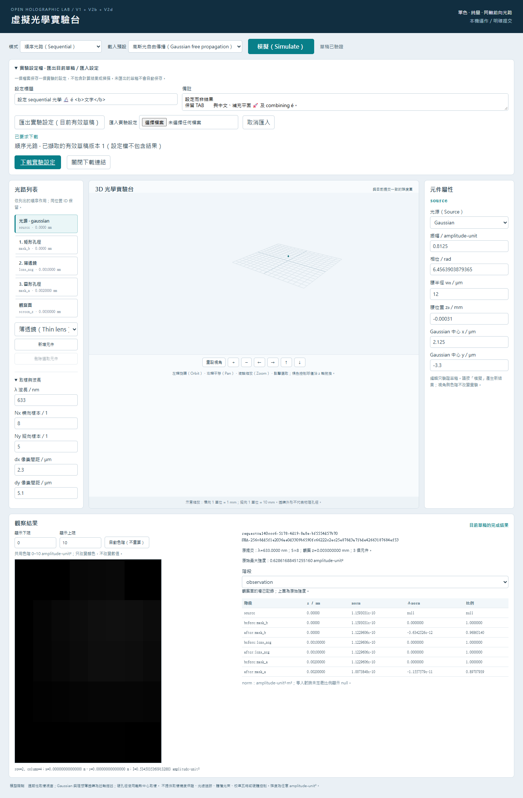
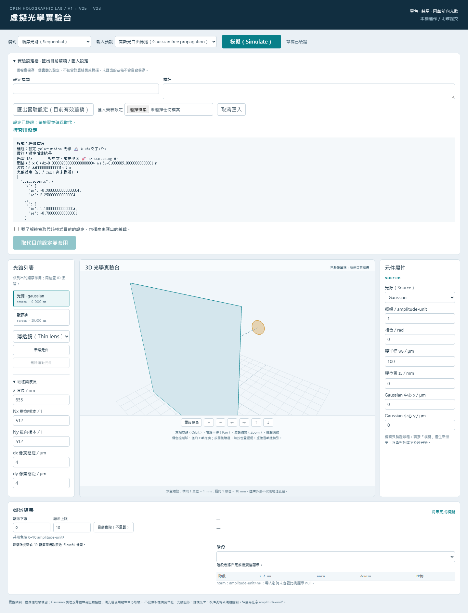
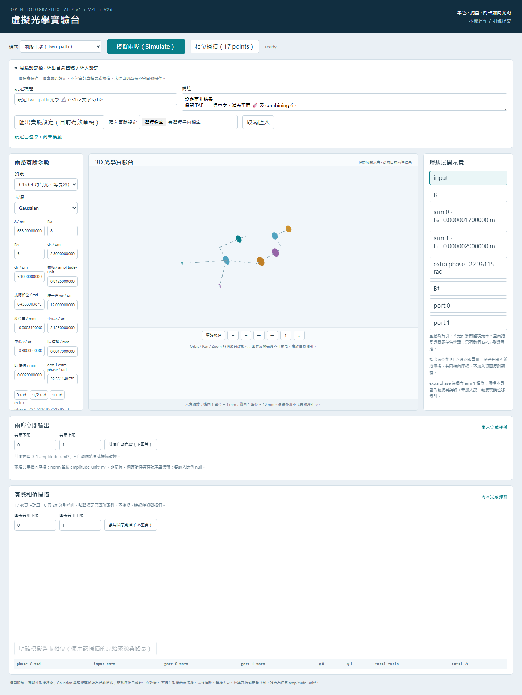

# V2e tests and evidence

Recorded 2026-10-12. Accepted baseline:
`9791db07ad182902fb027ab4e3caf9d2faccc966`.
All capture paths below are relative to the fresh owned ignored directory
`runs/v2e_acceptance_20261012_01/`. Each `*_command.json` records exact argv/cwd,
`*_exit.json` records actual exit/time, and `*_stdout.txt`/`*_stderr.txt` preserve
original stream bytes. Blocks below copy those streams without rewriting text.
Original failure outputs remain preserved separately from successful retries.
The schema, HTTP statuses, Unicode policy and digest coverage are in
[implementation_summary.md](implementation_summary.md).

Precommit acceptance is complete within the recorded scope. The Python suite
changed from **2523 passed, 1 skipped** to **2700 passed, 1 skipped** (177 new
cases, old tests unchanged). Frontend units changed from **186** to **222**
(36 new tests). Typecheck and production build passed. Ordinary legacy Chrome
passed **28** scenarios with **5** explicit controlled-only skips; document
Chrome passed **5** scenarios with **1** explicit held-worker-only skip.
All required controlled scenarios were separately executed: **17 browser
passes, 0 skips**, plus **7 partial-prefix API passes**. Isolated faults detected
**24/24 intended variants across 19 categories**, with original/restored passes
and exact production hashes unchanged. These are distinct executions, not a
single combined test count or blanket correctness/security certification.

Before implementation, main was clean, synchronized with origin/main (0/0),
and local/live remote matched the accepted baseline. Inventory covered 297
tracked files and 53 installed Python distribution version/location/metadata
records. The existing Windows-native Python 3.11.9 environment was used.
No install, upgrade, environment rebuild, global Git/configuration change,
port8501 management or historical-evidence rewrite occurred.

## Full baseline and restored final suites

### Baseline Python suite

Capture: `baseline_*`; exit 0. Cwd: `C:\holographiclab`.

```powershell
& 'C:\holographiclab\.venv\Scripts\python.exe' '-B' '-m' 'pytest' '-q' '-p' 'no:cacheprovider' '--basetemp' 'C:\holographiclab\runs\v2e_acceptance_20261012_01\baseline_tmp' '-rs'
```

Unedited stdout:

```text
........................................................................ [  2%]
........................................................................ [  5%]
........................................................................ [  8%]
........................................................................ [ 11%]
........................................................................ [ 14%]
........................................................................ [ 17%]
........................................................................ [ 19%]
........................................................................ [ 22%]
........................................................................ [ 25%]
........................................................................ [ 28%]
........................................................................ [ 31%]
........................................................................ [ 34%]
........................................................................ [ 37%]
........................................................................ [ 39%]
........................................................................ [ 42%]
........................................................................ [ 45%]
........................................................................ [ 48%]
........................................................................ [ 51%]
........................................................................ [ 54%]
........................................................................ [ 57%]
........................................................................ [ 59%]
........................................................................ [ 62%]
...................................................s.................... [ 65%]
........................................................................ [ 68%]
........................................................................ [ 71%]
........................................................................ [ 74%]
........................................................................ [ 77%]
........................................................................ [ 79%]
........................................................................ [ 82%]
........................................................................ [ 85%]
........................................................................ [ 88%]
........................................................................ [ 91%]
........................................................................ [ 94%]
........................................................................ [ 96%]
........................................................................ [ 99%]
....                                                                     [100%]
=========================== short test summary info ===========================
SKIPPED [1] tests\test_run_artifacts.py:1101: this Windows account lacks symlink privilege; junction is tested separately
2523 passed, 1 skipped in 216.06s (0:03:36)
```

Stderr: empty (0 bytes).

### Final Python suite after isolated fault restoration

Capture: `final_suite01_*`; exit 0. Cwd: `C:\holographiclab`.

```powershell
& 'C:\holographiclab\.venv\Scripts\python.exe' '-B' '-m' 'pytest' '-q' '-p' 'no:cacheprovider' '--basetemp' 'C:\holographiclab\runs\v2e_acceptance_20261012_01\final_tmp01' '-rs'
```

Unedited stdout:

```text
........................................................................ [  2%]
........................................................................ [  5%]
........................................................................ [  7%]
........................................................................ [ 10%]
........................................................................ [ 13%]
........................................................................ [ 15%]
........................................................................ [ 18%]
........................................................................ [ 21%]
........................................................................ [ 23%]
........................................................................ [ 26%]
........................................................................ [ 29%]
........................................................................ [ 31%]
........................................................................ [ 34%]
........................................................................ [ 37%]
........................................................................ [ 39%]
........................................................................ [ 42%]
........................................................................ [ 45%]
........................................................................ [ 47%]
........................................................................ [ 50%]
........................................................................ [ 53%]
........................................................................ [ 55%]
........................................................................ [ 58%]
...................................................s.................... [ 61%]
........................................................................ [ 63%]
........................................................................ [ 66%]
........................................................................ [ 69%]
........................................................................ [ 71%]
........................................................................ [ 74%]
........................................................................ [ 77%]
........................................................................ [ 79%]
........................................................................ [ 82%]
........................................................................ [ 85%]
........................................................................ [ 87%]
........................................................................ [ 90%]
........................................................................ [ 93%]
........................................................................ [ 95%]
........................................................................ [ 98%]
.....................................                                    [100%]
=========================== short test summary info ===========================
SKIPPED [1] tests\test_run_artifacts.py:1101: this Windows account lacks symlink privilege; junction is tested separately
2700 passed, 1 skipped in 302.95s (0:05:02)
```

Stderr: empty (0 bytes).

The only Python skip in both runs is unchanged:
`tests/test_run_artifacts.py:1101`: this Windows account lacks symlink privilege;
junction is tested separately. No privilege change or test modification was
used to remove it. The final suite used restored production sources. Its longer
wall time is an observation, not a numerical regression claim; controlled browser
acceptance was also running during this final invocation.

### Installed frontend baseline typecheck

Capture: `frontend_baseline_typecheck_*`; exit 0. Cwd: `C:\holographiclab\frontend\bench`.

```powershell
& 'C:\Program Files\nodejs\npm.cmd' 'run' '--ignore-scripts' 'typecheck'
```

Unedited stdout:

```text

> ohlab-virtual-bench@0.1.0 typecheck
> tsc --noEmit

```

Stderr: empty (0 bytes).

### Installed frontend baseline units after permission retry

Capture: `frontend_baseline_unit_permission_retry_*`; exit 0. Cwd: `C:\holographiclab\frontend\bench`.

```powershell
& 'C:\Program Files\nodejs\npm.cmd' 'run' '--ignore-scripts' 'test:unit'
```

Unedited stdout:

```text

> ohlab-virtual-bench@0.1.0 test:unit
> vitest run


 RUN  v5.0.3 C:/holographiclab/frontend/bench


 Test Files  10 passed (10)
      Tests  186 passed (186)
   Start at  15:38:49
   Duration  3.62s (import 57%, transform 20%, tests 18%, worker 4%)

    Isolate  10 workers spawned · ~202ms startup each (spawn + environment, per file)
             at least ~1.82s faster with isolate: false — reuses workers across files instead of one per file

```

Stderr: empty (0 bytes).

### Final frontend typecheck

Capture: `frontend_final_typecheck01_*`; exit 0. Cwd: `C:\holographiclab\frontend\bench`.

```powershell
& 'C:\Program Files\nodejs\node.exe' 'node_modules/typescript/bin/tsc' '--noEmit'
```

Stdout: empty (0 bytes).

Stderr: empty (0 bytes).

### Final frontend units after restored fault controls

Capture: `frontend_final_unit02_*`; exit 0. Cwd: `C:\holographiclab\frontend\bench`.

```powershell
& 'C:\Program Files\nodejs\npm.cmd' 'run' '--ignore-scripts' 'test:unit'
```

Unedited stdout:

```text

> ohlab-virtual-bench@0.1.0 test:unit
> vitest run


 RUN  v5.0.3 C:/holographiclab/frontend/bench


 Test Files  14 passed (14)
      Tests  222 passed (222)
   Start at  16:14:27
   Duration  3.81s (import 62%, tests 18%, transform 16%, worker 4%)

    Isolate  14 workers spawned · ~138ms startup each (spawn + environment, per file)
             at least ~1.80s faster with isolate: false — reuses workers across files instead of one per file

```

Stderr: empty (0 bytes).

### Final production build

Capture: `production_build02_*`; exit 0. Cwd: `C:\holographiclab\frontend\bench`.

```powershell
& 'C:\Program Files\nodejs\npm.cmd' 'run' '--ignore-scripts' 'build'
```

Unedited stdout:

```text

> ohlab-virtual-bench@0.1.0 build
> vite build

vite v8.3.2 building client environment for production...
transforming...
✓ 26 modules transformed.
rendering chunks...
computing gzip size...
dist/index.html                   0.55 kB │ gzip:   0.37 kB
dist/assets/index-awF3w3Tz.css    9.55 kB │ gzip:   2.64 kB
dist/assets/index-CSWnDYYZ.js   765.72 kB │ gzip: 197.49 kB

✓ built in 309ms
```

Unedited stderr:

```text
[plugin builtin:vite-reporter] 
(!) Some chunks are larger than 500 kB after minification. Consider:
- Using dynamic import() to code-split the application
- Use build.rolldownOptions.output.codeSplitting to improve chunking: https://rolldown.rs/reference/OutputOptions.codeSplitting
- Adjust chunk size limit for this warning via build.chunkSizeWarningLimit.
```

The >500kB minified chunk warning is preserved in the build stderr above.
No suppression, dependency change or unrelated code splitting was introduced.
`production_build01` had already passed before browser acceptance; build02
produced the same asset names and bytes. New browser-test-only fixes did not
change production code or assets.

## Independent API and actual browser portability

`independent_reference01` creates independent public-API results without HTTP
or browser execution. `api_v2e01` separately exercises the actual stateless
endpoint and ordinary computation. `independent_browser_compare03` compares
all original/restored Chrome captures and new direct public results, also
rerunning actual document/ordinary validation and simulation routes. All three
reports have `complete=true`; only the latter has
`browser_captures_compared=true`.

Each mode uses a mixed 5x8 anisotropic grid and nontrivial Gaussian source:
sequential has ordered rectangular aperture, negative lens and circular aperture;
two-path has unequal forward arms and a nonprincipal extra phase; polarization
has arbitrary complex coefficients, a noncommuting retarder/polarizer/retarder
train, a near-extinction angle and an off-centre selected readout. The fixture
manifest points to complete canonical documents; no expected result is inserted
into a product file.

For each mode the browser uploads a setup fixture, explicitly applies and
simulates, downloads through the real link, closes the original entire context,
physically renames/moves the consumed file, opens a new storage-isolated context,
uploads those actual bytes, previews and explicitly acknowledges replacement.
The original filename, tab, browser storage, process state and renderer are not
required. Setup import and portability restoration are recorded as separate
steps. The product exports only scientific inputs and literal metadata.

Every preview/application triggers zero compute POSTs. The intended target is
replaced coherently; other mode candidates retain all leaves. Explicit ordinary
simulation then yields a fresh request identity. Complete scientific headers
(excluding temporary request ID), payload arrays, coordinates, all scalar/stage
records and polarization complex samples compare exactly with original results
and direct public APIs: zero differing binary64 elements and maximum absolute
difference 0. No tolerance fallback was used. This verifies settings fidelity on
the tested identical-input same-platform path, not new optical accuracy.

`browser_v2e03/portability.json` identifies all seven actual capture paths per
mode. Downloaded/moved/reexported file bytes are identical. Every nonzero loaded
numeric leaf is preserved, including focal length, pitches, nonprincipal phases,
complex coefficients and near-extinction angles. Focus/unchanged input/blur,
camera moves, selection, mode-away/back and metadata edits leave science exact
and perform zero computation. Distinct imported lens values with the same `-20`
visible millimetre text retain their own binary64 identities. A real 647nm edit
changes only wavelength. This is not preservation of arbitrary original JSON
spacing/key order or negative-zero bits.

Canonicalization uses the declared Python UTF-8 policy; the final prepared
canonical document is an exact import/reexport fixed point. Existing mode zero
handling and JSON.stringify may make a first raw-valid response differ from the
final prepared response. Unit/API tests directly demonstrate ordinary-validation
scientific digest equality for all three modes, including legal signed zeros.
Metadata changes alter file bytes but not scientific digest; full-file hashes
are never installed as compute tokens. Both raw-to-first and first-to-second
nonzero drift are rejected before preview/application.

Chinese, supplementary characters, combining sequences and literal HTML text
are preserved. Scalar limits are tested independently from UTF-16 code units:
120 emoji title scalars pass and 121 reject. Notes permit TAB/LF; lone surrogates,
CR/forbidden controls, duplicate decoded keys, UTF-8/BOM, nonstandard constants,
overflow/nonzero-underflow, malformed recursion, unsupported fields/model/version
and numeric booleans reject. Byte caps are enforced before file decoding and
independently on canonical output; node/depth/token checks precede mode
construction. Some canonical-output boundary tests deliberately isolate the
encoder with test doubles; they do not claim an oversized legal optical model.
No global old-parser tightening occurred.

### Document API independent acceptance

Capture: `api_v2e01_*`; exit 0. Cwd: `C:\holographiclab`.

```powershell
& 'C:\holographiclab\.venv\Scripts\python.exe' '-B' '-X' 'utf8' 'scripts/validate_v2e_documents.py' '--output-dir' 'runs/v2e_acceptance_20261012_01/api_v2e01' '--base-url' 'http://127.0.0.1:8510'
```

Unedited stdout:

```text
fixtures=3; api_executed=True; browser_captures_compared=False; complete=True
```

Stderr: empty (0 bytes).

### Independent original/restored/direct comparison

Capture: `independent_browser_compare03_*`; exit 0. Cwd: `C:\holographiclab`.

```powershell
& 'C:\holographiclab\.venv\Scripts\python.exe' '-B' '-X' 'utf8' 'scripts/validate_v2e_documents.py' '--output-dir' 'runs/v2e_acceptance_20261012_01/independent_browser_compare03' '--base-url' 'http://127.0.0.1:8510' '--browser-evidence-dir' 'runs/v2e_acceptance_20261012_01/browser_v2e03'
```

Unedited stdout:

```text
fixtures=3; api_executed=True; browser_captures_compared=True; complete=True
```

Stderr: empty (0 bytes).

### Genuine document production-browser acceptance

Capture: `browser_v2e03_*`; exit 0. Cwd: `C:\holographiclab\frontend\bench`.

```powershell
& 'C:\Program Files\nodejs\node.exe' 'node_modules/@playwright/test/cli.js' 'test' 'tests/experiment_documents.browser.spec.ts' '--output' 'C:\holographiclab\runs\v2e_acceptance_20261012_01\browser_v2e03\test-results'
```

Unedited stdout:

```text

Running 6 tests using 1 worker

  ok 1 tests\experiment_documents.browser.spec.ts:83:27 › portable sequential: real download, closed context, renamed upload, explicit recomputation (4.1s)
  ok 2 tests\experiment_documents.browser.spec.ts:83:27 › portable two_path: real download, closed context, renamed upload, explicit recomputation (3.9s)
  ok 3 tests\experiment_documents.browser.spec.ts:83:27 › portable polarization: real download, closed context, renamed upload, explicit recomputation (4.4s)
  ok 4 tests\experiment_documents.browser.spec.ts:175:1 › invalid and cancelled import, scalar text, metadata and exact same-label replacements (2.2s)
  ok 5 tests\experiment_documents.browser.spec.ts:215:1 › stale stage-one/stage-two responses and frozen draft export cannot replace newer intent (2.0s)
  -  6 tests\experiment_documents.browser.spec.ts:254:1 › controlled document validation stays responsive under a real held worker and Apply rechecks busy

  1 skipped
  5 passed (18.3s)
```

Unedited stderr:

```text
(node:33528) Warning: The 'NO_COLOR' env is ignored due to the 'FORCE_COLOR' env being set.
(Use `node --trace-warnings ...` to show where the warning was created)
```

The one ordinary-document browser skip is the separately launched
`controlled document validation stays responsive under a real held worker and
Apply rechecks busy` scenario. It was explicitly executed for all five worker
holders below. It is not counted as an ordinary pass.

`transactions/outcome.json` records invalid/cancelled preservation, same-label
second-import bit identity, scalar lengths, metadata independence and one-field
isolation. `races/outcome.json` records cancelled replies in both stages and an
export frozen before a later real optical edit. Same-name, same-size A/B files
have explicitly different text. Only final valid replies can publish; a stale
first or second response cannot revive a preview/download.

Controller tests separately change busy state after preview and even during
preparation. Apply rechecks busy/context/generation/identity, prepares all
throwing work before the synchronous commit and changes only the target editor.
Failed preparation leaves exact previous state. Target current/retry/sweep
eligibility is cleared even for identical settings, and earlier results retain
original identities. Presentation errors remain subsequent, separate failures;
restoration never imports success or automatically submits science.

## Unchanged legacy production and controlled regressions

### Legacy sequential API: 10 cases

Capture: `api_v1_*`; exit 0. Cwd: `C:\holographiclab`.

```powershell
& 'C:\holographiclab\.venv\Scripts\python.exe' '-B' '-X' 'utf8' 'scripts/validate_v1_bench.py' '--output' 'runs/v2e_acceptance_20261012_01/api_v1.json'
```

Unedited stdout:

```text
{
  "passed": true,
  "cases": 10,
  "output": "runs\\v2e_acceptance_20261012_01\\api_v1.json",
  "source_location": "C:\\holographiclab\\src\\ohlab\\optics\\__init__.py",
  "served_asset_sha256": {
    "/assets/index-CSWnDYYZ.js": "8a1a597132a59bdbb33df5b1dcdbd902acf5543e377a6a39e2eee514ad3a5559",
    "/assets/index-awF3w3Tz.css": "e97f9feb64b23a54d08214399d8bc6a7810f0ac50211f85be532e77b2a8baa7f"
  }
}
```

Stderr: empty (0 bytes).

### Legacy two-path API: 18 cases and 3 sweeps

Capture: `api_v2b_*`; exit 0. Cwd: `C:\holographiclab`.

```powershell
& 'C:\holographiclab\.venv\Scripts\python.exe' '-B' '-X' 'utf8' 'scripts/validate_v2b_bench.py' '--output' 'runs/v2e_acceptance_20261012_01/api_v2b.json'
```

Unedited stdout:

```text
{
  "passed": true,
  "output": "runs\\v2e_acceptance_20261012_01\\api_v2b.json",
  "case_count": 18,
  "sweep_count": 3,
  "controlled_partial": null
}
```

Stderr: empty (0 bytes).

### Legacy polarization API: 28 cases and 3 sweeps

Capture: `api_v2d_*`; exit 0. Cwd: `C:\holographiclab`.

```powershell
& 'C:\holographiclab\.venv\Scripts\python.exe' '-B' '-X' 'utf8' 'scripts/validate_v2d_bench.py' '--output' 'runs/v2e_acceptance_20261012_01/api_v2d.json'
```

Unedited stdout:

```text
{
  "passed": true,
  "output": "C:\\holographiclab\\runs\\v2e_acceptance_20261012_01\\api_v2d.json",
  "cases": 28,
  "sweeps": 3,
  "controlled_partial_index": null
}
```

Stderr: empty (0 bytes).

### Unchanged sequential Chrome: 10 passed, 1 controlled skip

Capture: `browser_legacy01_*`; exit 0. Cwd: `C:\holographiclab\frontend\bench`.

```powershell
& 'C:\Program Files\nodejs\node.exe' 'node_modules/@playwright/test/cli.js' 'test' 'tests/bench.browser.spec.ts' '--grep' '.' '--output' 'C:\holographiclab\runs\v2e_acceptance_20261012_01\browser_legacy01\test-results'
```

Unedited stdout:

```text

Running 11 tests using 1 worker

  ok  1 tests\bench.browser.spec.ts:55:1 › production V0 lens/readout smoke and local-only assets (1.5s)
  ok  2 tests\bench.browser.spec.ts:74:1 › camera selection color resize and 3D picking do not alter optics or call API (3.3s)
  ok  3 tests\bench.browser.spec.ts:117:1 › real edits change V0 output; aperture uses shared limits and original norm loss; stale screenshot (4.1s)
  ok  4 tests\bench.browser.spec.ts:138:1 › source fields signed lens rectangle add delete numeric order and z ghost rail (3.9s)
  ok  5 tests\bench.browser.spec.ts:174:1 › rapid submissions remain single and edited pending response stays separately stale (1.3s)
  ok  6 tests\bench.browser.spec.ts:190:1 › malformed response and missing backend publish no fabricated success; reload passive; dark genuine (2.1s)
  ok  7 tests\bench.browser.spec.ts:226:1 › independent gray fixture catches extra gamma in actual WebGL and preserves raw float64 (1.0s)
  ok  8 tests\bench.browser.spec.ts:249:1 › independent asymmetric 3x4 and 2x5 display cells and original readouts (4.9s)
  ok  9 tests\bench.browser.spec.ts:294:1 › context loss and unsupported WebGL report presentation failure without automatic solve (1.7s)
  ok 10 tests\bench.browser.spec.ts:313:1 › predefined resource replacement sequence retains one active texture and bounded owned resources (9.0s)
  -  11 tests\bench.browser.spec.ts:329:1 › actual browser disconnect keeps running worker busy until controlled completion

  1 skipped
  10 passed (34.7s)
```

Unedited stderr:

```text
(node:55684) Warning: The 'NO_COLOR' env is ignored due to the 'FORCE_COLOR' env being set.
(Use `node --trace-warnings ...` to show where the warning was created)
```

### Unchanged two-path Chrome: 8 passed, 2 controlled skips

Capture: `browser_legacy_two_path01_*`; exit 0. Cwd: `C:\holographiclab\frontend\bench`.

```powershell
& 'C:\Program Files\nodejs\node.exe' 'node_modules/@playwright/test/cli.js' 'test' 'tests/two_path.browser.spec.ts' '--output' 'C:\holographiclab\runs\v2e_acceptance_20261012_01\browser_legacy_two_path01\test-results'
```

Unedited stdout:

```text

Running 10 tests using 1 worker

  ok  1 tests\two_path.browser.spec.ts:144:1 › genuine dual known phases and both original readouts use one submitted V2a result (4.2s)
  ok  2 tests\two_path.browser.spec.ts:175:1 › real Gaussian source distance phase edits preserve shared scale and original input diagnostics (7.6s)
  ok  3 tests\two_path.browser.spec.ts:193:1 › asymmetric actual port arrays preserve common transverse axes aspect and unlit shared grayscale (21.1s)
  ok  4 tests\two_path.browser.spec.ts:234:1 › presentation controls never calculate and scientific edits detach both textures immediately (2.6s)
  ok  5 tests\two_path.browser.spec.ts:255:1 › rapid genuine submissions and away-back mode changes reject held cross-mode attachments (1.9s)
  ok  6 tests\two_path.browser.spec.ts:273:1 › real dark outputs malformed error recovery signed-zero policy and passive reload (3.3s)
  ok  7 tests\two_path.browser.spec.ts:300:1 › real seventeen-point sweep displays actual markers with no chart-click computation (1.9s)
  -   8 tests\two_path.browser.spec.ts:315:1 › controlled partial failure retains only genuine prefix and never labels sweep complete
  -   9 tests\two_path.browser.spec.ts:331:1 › actual two-path browser disconnect holds all numerical routes until genuine worker completion
  ok 10 tests\two_path.browser.spec.ts:374:1 › context loss preserves numerical completion and repeated mode replacement ownership is bounded (9.4s)

  2 skipped
  8 passed (54.2s)
```

Unedited stderr:

```text
(node:38212) Warning: The 'NO_COLOR' env is ignored due to the 'FORCE_COLOR' env being set.
(Use `node --trace-warnings ...` to show where the warning was created)
```

### Unchanged polarization Chrome: 10 passed, 2 controlled skips

Capture: `browser_legacy_polarization01_*`; exit 0. Cwd: `C:\holographiclab\frontend\bench`.

```powershell
& 'C:\Program Files\nodejs\node.exe' 'node_modules/@playwright/test/cli.js' 'test' 'tests/polarization.browser.spec.ts' '--output' 'C:\holographiclab\runs\v2e_acceptance_20261012_01\browser_legacy_polarization01\test-results'
```

Unedited stdout:

```text

Running 12 tests using 1 worker

  ok  1 tests\polarization.browser.spec.ts:103:1 › genuine QWP HWP and common phase retain actual complex samples at shared fixed tau (12.8s)
  ok  2 tests\polarization.browser.spec.ts:127:1 › real order coefficients source and element editing preserve loss and explicit original identity (22.4s)
  ok  3 tests\polarization.browser.spec.ts:160:1 › genuine thirteen-point full-train sweep has passive inspection and one explicit apply simulation (4.6s)
  ok  4 tests\polarization.browser.spec.ts:178:1 › actual asymmetric float64 intensity picking does not relabel the submitted complex sample (5.1s)
  ok  5 tests\polarization.browser.spec.ts:204:1 › dark and selected weak public samples remain distinct and display actions send no scientific requests (13.2s)
  ok  6 tests\polarization.browser.spec.ts:233:1 › controlled nonzero tiny sample with zero squared intensity is not exact darkness (3.6s)
  ok  7 tests\polarization.browser.spec.ts:256:1 › invalid text numerical failure malformed reply and signed zero require deliberate recovery (7.8s)
  ok  8 tests\polarization.browser.spec.ts:276:1 › rapid clicks and away-and-back across all modes reject an actual held late result (4.0s)
  ok  9 tests\polarization.browser.spec.ts:292:1 › later presentation failure keeps numerical completion and original result without automatic resubmission (4.3s)
  ok 10 tests\polarization.browser.spec.ts:352:1 › repeated play pause replacement mode switches and actual context loss preserve bounded owners (15.2s)
  -  11 tests\polarization.browser.spec.ts:386:1 › controlled actual failed sweep keeps only genuine contiguous rows
  -  12 tests\polarization.browser.spec.ts:400:1 › actual polarization browser disconnect holds all five operations until genuine worker completion

  2 skipped
  10 passed (1.6m)
```

Unedited stderr:

```text
(node:51480) Warning: The 'NO_COLOR' env is ignored due to the 'FORCE_COLOR' env being set.
(Use `node --trace-warnings ...` to show where the warning was created)
```

The five skipped legacy scenarios are sequential disconnect, two-path partial
and disconnect, polarization partial and disconnect. All existing assertions
and the controlled harness remain byte-identical. Separate actual controlled
children exercise seven partial cases (polarization indices 0/3/12 for numerical
and unexpected failures plus legacy two-path index3) and five disconnect worker
holders. Numerical failure retains genuine contiguous rows with HTTP422;
unexpected failure is HTTP500. No fabricated suffix, automatic retry, premature
gate release or cancelled-worker termination is accepted.

Five additional document-held runs cover sequential, dual, sweep, polarization
and polarization_sweep. A preview is prepared before busy, Apply is rejected
while the genuine worker/gate is held, raw document validation remains responsive
without changing busy, and an owned release.flag permits actual numerical work
and encoding to finish. These use the unchanged explicit test harness, not a
production fault endpoint. Every child uses exclusive fixed 127.0.0.1:8510 and
is closed through its exact owned Popen handle after idle health.
`controlled17summary.json` aggregates exact labels, outcomes, cleanup and
protected harness/test hashes. No unrelated service is managed.

### Controlled legacy browser: legacy_disconnect_dual01

Capture: `controlled_browser_legacy_disconnect_dual01_*`; exit 0. Cwd: `C:\holographiclab\frontend\bench`.

```powershell
& 'C:\Program Files\nodejs\node.exe' 'node_modules/@playwright/test/cli.js' 'test' 'tests/two_path.browser.spec.ts' '--grep' 'actual two-path browser disconnect' '--output' 'C:\holographiclab\runs\v2e_acceptance_20261012_01\controlled_browser_legacy_disconnect_dual01\test-results'
```

Unedited stdout:

```text

Running 1 test using 1 worker

  ok 1 tests\two_path.browser.spec.ts:331:1 › actual two-path browser disconnect holds all numerical routes until genuine worker completion (2.8s)

  1 passed (3.9s)
```

Unedited stderr:

```text
(node:23344) Warning: The 'NO_COLOR' env is ignored due to the 'FORCE_COLOR' env being set.
(Use `node --trace-warnings ...` to show where the warning was created)
```

### Controlled legacy browser: legacy_disconnect_polarization01

Capture: `controlled_browser_legacy_disconnect_polarization01_*`; exit 0. Cwd: `C:\holographiclab\frontend\bench`.

```powershell
& 'C:\Program Files\nodejs\node.exe' 'node_modules/@playwright/test/cli.js' 'test' 'tests/polarization.browser.spec.ts' '--grep' 'actual polarization browser disconnect' '--output' 'C:\holographiclab\runs\v2e_acceptance_20261012_01\controlled_browser_legacy_disconnect_polarization01\test-results'
```

Unedited stdout:

```text

Running 1 test using 1 worker

  ok 1 tests\polarization.browser.spec.ts:400:1 › actual polarization browser disconnect holds all five operations until genuine worker completion (7.8s)

  1 passed (9.1s)
```

Unedited stderr:

```text
(node:24732) Warning: The 'NO_COLOR' env is ignored due to the 'FORCE_COLOR' env being set.
(Use `node --trace-warnings ...` to show where the warning was created)
```

### Controlled legacy browser: legacy_disconnect_polarization_sweep01

Capture: `controlled_browser_legacy_disconnect_polarization_sweep01_*`; exit 0. Cwd: `C:\holographiclab\frontend\bench`.

```powershell
& 'C:\Program Files\nodejs\node.exe' 'node_modules/@playwright/test/cli.js' 'test' 'tests/polarization.browser.spec.ts' '--grep' 'actual polarization browser disconnect' '--output' 'C:\holographiclab\runs\v2e_acceptance_20261012_01\controlled_browser_legacy_disconnect_polarization_sweep01\test-results'
```

Unedited stdout:

```text

Running 1 test using 1 worker

  ok 1 tests\polarization.browser.spec.ts:400:1 › actual polarization browser disconnect holds all five operations until genuine worker completion (7.5s)

  1 passed (8.4s)
```

Unedited stderr:

```text
(node:54720) Warning: The 'NO_COLOR' env is ignored due to the 'FORCE_COLOR' env being set.
(Use `node --trace-warnings ...` to show where the warning was created)
```

### Controlled legacy browser: legacy_disconnect_sequential01

Capture: `controlled_browser_legacy_disconnect_sequential01_*`; exit 0. Cwd: `C:\holographiclab\frontend\bench`.

```powershell
& 'C:\Program Files\nodejs\node.exe' 'node_modules/@playwright/test/cli.js' 'test' 'tests/bench.browser.spec.ts' '--grep' 'actual browser disconnect keeps' '--output' 'C:\holographiclab\runs\v2e_acceptance_20261012_01\controlled_browser_legacy_disconnect_sequential01\test-results'
```

Unedited stdout:

```text

Running 1 test using 1 worker

  ok 1 tests\bench.browser.spec.ts:329:1 › actual browser disconnect keeps running worker busy until controlled completion (2.3s)

  1 passed (3.2s)
```

Unedited stderr:

```text
(node:50204) Warning: The 'NO_COLOR' env is ignored due to the 'FORCE_COLOR' env being set.
(Use `node --trace-warnings ...` to show where the warning was created)
```

### Controlled legacy browser: legacy_disconnect_sweep01

Capture: `controlled_browser_legacy_disconnect_sweep01_*`; exit 0. Cwd: `C:\holographiclab\frontend\bench`.

```powershell
& 'C:\Program Files\nodejs\node.exe' 'node_modules/@playwright/test/cli.js' 'test' 'tests/two_path.browser.spec.ts' '--grep' 'actual two-path browser disconnect' '--output' 'C:\holographiclab\runs\v2e_acceptance_20261012_01\controlled_browser_legacy_disconnect_sweep01\test-results'
```

Unedited stdout:

```text

Running 1 test using 1 worker

  ok 1 tests\two_path.browser.spec.ts:331:1 › actual two-path browser disconnect holds all numerical routes until genuine worker completion (2.8s)

  1 passed (3.6s)
```

Unedited stderr:

```text
(node:19476) Warning: The 'NO_COLOR' env is ignored due to the 'FORCE_COLOR' env being set.
(Use `node --trace-warnings ...` to show where the warning was created)
```

### Controlled legacy browser: legacy_pol_partial_i0_numerical01

Capture: `controlled_browser_legacy_pol_partial_i0_numerical01_*`; exit 0. Cwd: `C:\holographiclab\frontend\bench`.

```powershell
& 'C:\Program Files\nodejs\node.exe' 'node_modules/@playwright/test/cli.js' 'test' 'tests/polarization.browser.spec.ts' '--grep' 'controlled actual failed sweep' '--output' 'C:\holographiclab\runs\v2e_acceptance_20261012_01\controlled_browser_legacy_pol_partial_i0_numerical01\test-results'
```

Unedited stdout:

```text

Running 1 test using 1 worker

  ok 1 tests\polarization.browser.spec.ts:386:1 › controlled actual failed sweep keeps only genuine contiguous rows (3.4s)

  1 passed (4.6s)
```

Unedited stderr:

```text
(node:17468) Warning: The 'NO_COLOR' env is ignored due to the 'FORCE_COLOR' env being set.
(Use `node --trace-warnings ...` to show where the warning was created)
```

### Controlled legacy browser: legacy_pol_partial_i0_unexpected01

Capture: `controlled_browser_legacy_pol_partial_i0_unexpected01_*`; exit 0. Cwd: `C:\holographiclab\frontend\bench`.

```powershell
& 'C:\Program Files\nodejs\node.exe' 'node_modules/@playwright/test/cli.js' 'test' 'tests/polarization.browser.spec.ts' '--grep' 'controlled actual failed sweep' '--output' 'C:\holographiclab\runs\v2e_acceptance_20261012_01\controlled_browser_legacy_pol_partial_i0_unexpected01\test-results'
```

Unedited stdout:

```text

Running 1 test using 1 worker

  ok 1 tests\polarization.browser.spec.ts:386:1 › controlled actual failed sweep keeps only genuine contiguous rows (3.3s)

  1 passed (4.0s)
```

Unedited stderr:

```text
(node:42244) Warning: The 'NO_COLOR' env is ignored due to the 'FORCE_COLOR' env being set.
(Use `node --trace-warnings ...` to show where the warning was created)
```

### Controlled legacy browser: legacy_pol_partial_i12_numerical01

Capture: `controlled_browser_legacy_pol_partial_i12_numerical01_*`; exit 0. Cwd: `C:\holographiclab\frontend\bench`.

```powershell
& 'C:\Program Files\nodejs\node.exe' 'node_modules/@playwright/test/cli.js' 'test' 'tests/polarization.browser.spec.ts' '--grep' 'controlled actual failed sweep' '--output' 'C:\holographiclab\runs\v2e_acceptance_20261012_01\controlled_browser_legacy_pol_partial_i12_numerical01\test-results'
```

Unedited stdout:

```text

Running 1 test using 1 worker

  ok 1 tests\polarization.browser.spec.ts:386:1 › controlled actual failed sweep keeps only genuine contiguous rows (3.3s)

  1 passed (4.1s)
```

Unedited stderr:

```text
(node:13988) Warning: The 'NO_COLOR' env is ignored due to the 'FORCE_COLOR' env being set.
(Use `node --trace-warnings ...` to show where the warning was created)
```

### Controlled legacy browser: legacy_pol_partial_i12_unexpected01

Capture: `controlled_browser_legacy_pol_partial_i12_unexpected01_*`; exit 0. Cwd: `C:\holographiclab\frontend\bench`.

```powershell
& 'C:\Program Files\nodejs\node.exe' 'node_modules/@playwright/test/cli.js' 'test' 'tests/polarization.browser.spec.ts' '--grep' 'controlled actual failed sweep' '--output' 'C:\holographiclab\runs\v2e_acceptance_20261012_01\controlled_browser_legacy_pol_partial_i12_unexpected01\test-results'
```

Unedited stdout:

```text

Running 1 test using 1 worker

  ok 1 tests\polarization.browser.spec.ts:386:1 › controlled actual failed sweep keeps only genuine contiguous rows (3.4s)

  1 passed (4.6s)
```

Unedited stderr:

```text
(node:39204) Warning: The 'NO_COLOR' env is ignored due to the 'FORCE_COLOR' env being set.
(Use `node --trace-warnings ...` to show where the warning was created)
```

### Controlled legacy browser: legacy_pol_partial_i3_numerical01

Capture: `controlled_browser_legacy_pol_partial_i3_numerical01_*`; exit 0. Cwd: `C:\holographiclab\frontend\bench`.

```powershell
& 'C:\Program Files\nodejs\node.exe' 'node_modules/@playwright/test/cli.js' 'test' 'tests/polarization.browser.spec.ts' '--grep' 'controlled actual failed sweep' '--output' 'C:\holographiclab\runs\v2e_acceptance_20261012_01\controlled_browser_legacy_pol_partial_i3_numerical01\test-results'
```

Unedited stdout:

```text

Running 1 test using 1 worker

  ok 1 tests\polarization.browser.spec.ts:386:1 › controlled actual failed sweep keeps only genuine contiguous rows (3.3s)

  1 passed (4.3s)
```

Unedited stderr:

```text
(node:28368) Warning: The 'NO_COLOR' env is ignored due to the 'FORCE_COLOR' env being set.
(Use `node --trace-warnings ...` to show where the warning was created)
```

### Controlled legacy browser: legacy_pol_partial_i3_unexpected01

Capture: `controlled_browser_legacy_pol_partial_i3_unexpected01_*`; exit 0. Cwd: `C:\holographiclab\frontend\bench`.

```powershell
& 'C:\Program Files\nodejs\node.exe' 'node_modules/@playwright/test/cli.js' 'test' 'tests/polarization.browser.spec.ts' '--grep' 'controlled actual failed sweep' '--output' 'C:\holographiclab\runs\v2e_acceptance_20261012_01\controlled_browser_legacy_pol_partial_i3_unexpected01\test-results'
```

Unedited stdout:

```text

Running 1 test using 1 worker

  ok 1 tests\polarization.browser.spec.ts:386:1 › controlled actual failed sweep keeps only genuine contiguous rows (3.4s)

  1 passed (4.5s)
```

Unedited stderr:

```text
(node:9440) Warning: The 'NO_COLOR' env is ignored due to the 'FORCE_COLOR' env being set.
(Use `node --trace-warnings ...` to show where the warning was created)
```

### Controlled legacy browser: legacy_v2b_partial_i3_numerical01

Capture: `controlled_browser_legacy_v2b_partial_i3_numerical01_*`; exit 0. Cwd: `C:\holographiclab\frontend\bench`.

```powershell
& 'C:\Program Files\nodejs\node.exe' 'node_modules/@playwright/test/cli.js' 'test' 'tests/two_path.browser.spec.ts' '--grep' 'controlled partial failure' '--output' 'C:\holographiclab\runs\v2e_acceptance_20261012_01\controlled_browser_legacy_v2b_partial_i3_numerical01\test-results'
```

Unedited stdout:

```text

Running 1 test using 1 worker

  ok 1 tests\two_path.browser.spec.ts:315:1 › controlled partial failure retains only genuine prefix and never labels sweep complete (1.3s)

  1 passed (2.3s)
```

Unedited stderr:

```text
(node:56272) Warning: The 'NO_COLOR' env is ignored due to the 'FORCE_COLOR' env being set.
(Use `node --trace-warnings ...` to show where the warning was created)
```

### Controlled document browser: documents_held_dual01

Capture: `controlled_document_browser_documents_held_dual01_*`; exit 0. Cwd: `C:\holographiclab\frontend\bench`.

```powershell
& 'C:\Program Files\nodejs\node.exe' 'node_modules/@playwright/test/cli.js' 'test' 'tests/experiment_documents.browser.spec.ts' '--grep' 'controlled document validation' '--output' 'C:\holographiclab\runs\v2e_acceptance_20261012_01\controlled_document_browser_documents_held_dual01\test-results'
```

Unedited stdout:

```text

Running 1 test using 1 worker

  ok 1 tests\experiment_documents.browser.spec.ts:254:1 › controlled document validation stays responsive under a real held worker and Apply rechecks busy (1.7s)

  1 passed (2.7s)
```

Unedited stderr:

```text
(node:34104) Warning: The 'NO_COLOR' env is ignored due to the 'FORCE_COLOR' env being set.
(Use `node --trace-warnings ...` to show where the warning was created)
```

### Controlled document browser: documents_held_polarization01

Capture: `controlled_document_browser_documents_held_polarization01_*`; exit 0. Cwd: `C:\holographiclab\frontend\bench`.

```powershell
& 'C:\Program Files\nodejs\node.exe' 'node_modules/@playwright/test/cli.js' 'test' 'tests/experiment_documents.browser.spec.ts' '--grep' 'controlled document validation' '--output' 'C:\holographiclab\runs\v2e_acceptance_20261012_01\controlled_document_browser_documents_held_polarization01\test-results'
```

Unedited stdout:

```text

Running 1 test using 1 worker

  ok 1 tests\experiment_documents.browser.spec.ts:254:1 › controlled document validation stays responsive under a real held worker and Apply rechecks busy (1.6s)

  1 passed (2.6s)
```

Unedited stderr:

```text
(node:40704) Warning: The 'NO_COLOR' env is ignored due to the 'FORCE_COLOR' env being set.
(Use `node --trace-warnings ...` to show where the warning was created)
```

### Controlled document browser: documents_held_polarization_sweep01

Capture: `controlled_document_browser_documents_held_polarization_sweep01_*`; exit 0. Cwd: `C:\holographiclab\frontend\bench`.

```powershell
& 'C:\Program Files\nodejs\node.exe' 'node_modules/@playwright/test/cli.js' 'test' 'tests/experiment_documents.browser.spec.ts' '--grep' 'controlled document validation' '--output' 'C:\holographiclab\runs\v2e_acceptance_20261012_01\controlled_document_browser_documents_held_polarization_sweep01\test-results'
```

Unedited stdout:

```text

Running 1 test using 1 worker

  ok 1 tests\experiment_documents.browser.spec.ts:254:1 › controlled document validation stays responsive under a real held worker and Apply rechecks busy (1.5s)

  1 passed (2.4s)
```

Unedited stderr:

```text
(node:35488) Warning: The 'NO_COLOR' env is ignored due to the 'FORCE_COLOR' env being set.
(Use `node --trace-warnings ...` to show where the warning was created)
```

### Controlled document browser: documents_held_sequential01

Capture: `controlled_document_browser_documents_held_sequential01_*`; exit 0. Cwd: `C:\holographiclab\frontend\bench`.

```powershell
& 'C:\Program Files\nodejs\node.exe' 'node_modules/@playwright/test/cli.js' 'test' 'tests/experiment_documents.browser.spec.ts' '--grep' 'controlled document validation' '--output' 'C:\holographiclab\runs\v2e_acceptance_20261012_01\controlled_document_browser_documents_held_sequential01\test-results'
```

Unedited stdout:

```text

Running 1 test using 1 worker

  ok 1 tests\experiment_documents.browser.spec.ts:254:1 › controlled document validation stays responsive under a real held worker and Apply rechecks busy (1.6s)

  1 passed (2.8s)
```

Unedited stderr:

```text
(node:25176) Warning: The 'NO_COLOR' env is ignored due to the 'FORCE_COLOR' env being set.
(Use `node --trace-warnings ...` to show where the warning was created)
```

### Controlled document browser: documents_held_sweep01

Capture: `controlled_document_browser_documents_held_sweep01_*`; exit 0. Cwd: `C:\holographiclab\frontend\bench`.

```powershell
& 'C:\Program Files\nodejs\node.exe' 'node_modules/@playwright/test/cli.js' 'test' 'tests/experiment_documents.browser.spec.ts' '--grep' 'controlled document validation' '--output' 'C:\holographiclab\runs\v2e_acceptance_20261012_01\controlled_document_browser_documents_held_sweep01\test-results'
```

Unedited stdout:

```text

Running 1 test using 1 worker

  ok 1 tests\experiment_documents.browser.spec.ts:254:1 › controlled document validation stays responsive under a real held worker and Apply rechecks busy (1.5s)

  1 passed (2.6s)
```

Unedited stderr:

```text
(node:36840) Warning: The 'NO_COLOR' env is ignored due to the 'FORCE_COLOR' env being set.
(Use `node --trace-warnings ...` to show where the warning was created)
```

## Isolated fault controls and resource ownership

### Final combined isolated fault controls

Capture: `negative_final01_*`; exit 0. Cwd: `C:\holographiclab`.

```powershell
& 'C:\holographiclab\.venv\Scripts\python.exe' '-B' '-X' 'utf8' 'scripts/v2e_negative_controls.py' '--output-dir' 'runs/v2e_acceptance_20261012_01/negative_final01'
```

Unedited stdout:

```text
rounded_scientific_serialization: original=0, fault=1, intended_assertion=True, restored=0
wrong_document_model: original=0, fault=1, intended_assertion=True, restored=0
reordered_stable_elements: original=0, fault=1, intended_assertion=True, restored=0
reset_arbitrary_coefficient: original=0, fault=1, intended_assertion=True, restored=0
duplicate_keys_erased_before_validation: original=0, fault=1, intended_assertion=True, restored=0
accept_imported_success_fields: original=0, fault=1, intended_assertion=True, restored=0
document_releases_active_science_gate: original=0, fault=1, intended_assertion=True, restored=0
dynamic_dependency_bypass: original=0, fault=1, intended_assertion=True, restored=0
decimal_underflow_accepted: original=0, fault=1, intended_assertion=True, restored=0
unicode_scalar_limit_doubled: original=0, fault=1, intended_assertion=True, restored=0
file_digest_mistaken_for_scientific_digest: original=0, fault=1, intended_assertion=True, restored=0
untouched_si_reconverted_from_display: original=0, fault=1, intended_assertion=True, restored=0
same_formatted_import_reuses_old_generation: original=0, fault=1, intended_assertion=True, restored=0
frozen_export_relabelled_as_later_draft: original=0, fault=1, intended_assertion=True, restored=0
raw_upload_parse_stringified_in_transport: original=0, fault=1, intended_assertion=True, restored=0
first_authoritative_stage_drift_ignored: original=0, fault=1, intended_assertion=True, restored=0
second_authoritative_stage_drift_ignored: original=0, fault=1, intended_assertion=True, restored=0
partial_editor_before_failed_correspondence: original=0, fault=1, intended_assertion=True, restored=0
stale_import_survives_edit_in_both_stages: original=0, fault=1, intended_assertion=True, restored=0
automatic_simulation_during_settings_commit: original=0, fault=1, intended_assertion=True, restored=0
prepared_download_url_revoked_early: original=0, fault=1, intended_assertion=True, restored=0
prepared_download_urls_leaked: original=0, fault=1, intended_assertion=True, restored=0
unicode_scalars_counted_as_utf16_units: original=0, fault=1, intended_assertion=True, restored=0
first_digest_installed_after_final_validation: original=0, fault=1, intended_assertion=True, restored=0
production_unchanged=True; intended_variants=24/24
```

Stderr: empty (0 bytes).

All originals and restored copied-source tests passed; all faults failed at
named intended assertions, not collection/import/setup. The stale-response
variant exercises both stage settlements. Production files remained frozen and
hash-identical throughout the final combined run. Earlier diagnostic runs
`negative_probe03` (13 frontend variants) and `negative_probe04` (11 backend)
are supplementary, not additional unique variants. `negative_probe02` stopped
before tests on worker spawn EPERM and is not a detection. Full mutation bytes,
original/fault/restored command streams, copied import locations, intended
markers, exact restoration and production-before/after hashes remain recorded.
Fault copies never alter production code, instructions, packages or history.

Actual browser ownership after dismissing a completed download reports zero
URLs/readers/fetches for all three modes. Unit lifetime checks exercise five
successive downloads, abort/supersession, actual byte lengths and page disposal;
faults demonstrate both early URL revocation and leaks are detected. One active
reader/fetch/operation, one queued latest intent, one preview and one prepared
URL have bounded ownership. Failed replacement preserves a still-useful earlier
download; no URL is revoked immediately on click or on an arbitrary timer.

Document actual buffers, Blob bytes, logical UTF-16 string charges and reader
reservations count with existing all-mode ownership. Incoming file admission
precedes FileReader allocation. Pending operations reserve 131072 future
persistent bytes and 524288 transient bytes; active scientific reservations
are included in the reverse admission direction and released on gate idle.
The existing 16 MiB persistent/32 MiB transient caps are unchanged. No retained
science is discarded to make room. These are conservative app-owned bounds,
not measurements of whole JS heap/tab/process/GPU memory.

## Preserved failures and verification corrections

`frontend_baseline_unit` failed before assertions on Vite spawn EPERM; the
normal permission retry passed without changes to tools or isolation policy.
The enclosing initial capture print also encountered cp950 UnicodeEncodeError
after stream capture; original byte files remained intact and later orchestration
uses -Xutf8. `backend_focused01` had 268 passed and 2 setup/teardown errors because
long newly parametrized test IDs exceeded the Windows 32767 environment-variable
limit via PYTEST_CURRENT_TEST. Only new test IDs were shortened.
`backend_recursion_reproducer04` deliberately demonstrated an unwrapped second
numeric-hook decode RecursionError (1 failed, 2 passed, 41 deselected). The document
boundary now wraps it. Real 1500-complete/3000-open nesting already returned 400
before that fix; they are not falsely claimed as formerly 500.
`backend_all_bench05` subsequently passed 517 bench tests.

`frontend_work_unit01` had 217 passed and 1 real new reader-admission failure; the
missing admission-before-read was corrected and final units passed 222.
`browser_v2e01` failed 5 setup scenarios because the manifest was treated as a
document; the loader now resolves contained canonical_file paths and fresh
contexts have an explicit loopback baseURL. `browser_v2e02` passed 3 portability
cases but failed 2 edit scenarios because 633 nm was already displayed. Correct
unchanged-text preservation made those edits no-ops. New tests now deliberately
edit 647 nm and retain exact assertions; `browser_v2e03` passed all 5.
The race fixture's earlier absent-character replacement was also corrected and
explicitly asserts distinct same-size contents. No production behavior was
weakened to satisfy a faulty fixture.

`frontend_final_unit01` was a setup failure from a nonexistent guessed config
path; no test ran. The verified existing test:unit command passed in unit02.
Production build02 then passed. These failures remain separate from passes.

A first post-service probe accepted any nonzero connect_ex result and labelled
it refusal. That check was insufficient:10035 can be WSAEWOULDBLOCK. The original
production_service_cleanup01 record remains preserved; observed graceful
owned-PID shutdown is independent evidence, while later controlled aggregate
checks and clean-postcommit exclusive binding provide authoritative listener
state. No ambiguous socket error is relabelled as a successful HTTP check.
Normal permission mechanisms were used for required workers/network checks;
no proxy/certificate/TLS/configuration bypass or alternate port was used.

| Preserved failed capture | Stream | Bytes | SHA256 |
|---|---|---:|---|

| `backend_focused01` | stdout | 138013 | `f2f16468888868799d50a60e38a39fefbca1c2e0c9deeb39130b4f0e8efc6e0d` |
| `backend_focused01` | stderr | 0 | `e3b0c44298fc1c149afbf4c8996fb92427ae41e4649b934ca495991b7852b855` |
| `backend_recursion_reproducer04` | stdout | 1662 | `5d1d703ef083dbcf90479d37a0717f9bed0df37e25203b5e62d0ee840bcf666d` |
| `backend_recursion_reproducer04` | stderr | 0 | `e3b0c44298fc1c149afbf4c8996fb92427ae41e4649b934ca495991b7852b855` |
| `browser_v2e01` | stdout | 8475 | `d8ab209ea9bfbbe62437f8ba8b96614300f8d5398de9be7b235f690c44ba9bee` |
| `browser_v2e01` | stderr | 984 | `1c61ab8fd5f8782dcc3bfa34e1a671ba16a67015174ebe4639c7fc8de407c729` |
| `browser_v2e02` | stdout | 5554 | `690e33f0d1e98ad4070e1ae2a28eeb8c61db8166bde5d993ab8e2ee647442088` |
| `browser_v2e02` | stderr | 492 | `ad729e11b63f2c8a0b93dba6fa0a00db260963b87cb939266aff6ae9173bdd65` |
| `frontend_baseline_unit` | stdout | 53 | `05a50426fd406e706da400803ffc6bb2635bb350b647b6dec4983658064463a1` |
| `frontend_baseline_unit` | stderr | 2456 | `7f8e733a7cbc775d2c1402764ff0008719c89e9c19660d8b82dc830aabcae28f` |
| `frontend_final_unit01` | stdout | 0 | `e3b0c44298fc1c149afbf4c8996fb92427ae41e4649b934ca495991b7852b855` |
| `frontend_final_unit01` | stderr | 1641 | `29bc020f66e51294ed0b8946851e7754f7f740d9793495a600d9550575173950` |
| `frontend_work_unit01` | stdout | 688 | `9f6e1b0667e44dc44705477ad4c81a04ae42ec648a90ed573a8826b4c0ba918d` |
| `frontend_work_unit01` | stderr | 903 | `196f7718db71e5f798db442548cbf75678b8b61d2367869a14c3ecfa27375a99` |

## Genuine figures, exact scope and publication gates



Real sequential current-draft download requested after explicit original simulation. Captured by real Chrome during browser_v2e03 and visually inspected. Literal HTML remains text. Rounded UI numbers/images are not numeric correctness evidence.



Polarization settings preview in a fresh context; target not yet replaced. Captured by real Chrome during browser_v2e03 and visually inspected. Literal HTML remains text. Rounded UI numbers/images are not numeric correctness evidence.



Fresh-context two-path settings explicitly restored without a result. Captured by real Chrome during browser_v2e03 and visually inspected. Literal HTML remains text. Rounded UI numbers/images are not numeric correctness evidence.

Exact approved scope: 11 modified +24 created paths. All 286 pre-existing tracked
files outside that allowlist remain byte-identical, including numerical source,
old tests/protocols/architecture guards, M5, Streamlit, dependency declarations,
lockfile, instructions, math conventions and historical handoffs. All 53 Python
distribution metadata/version/location records remain unchanged. The exact
approved inventory follows; precommit_scope.json/staged_scope.json and final
committed/published snapshots provide actual protected/index comparisons.
No package installation, environment rebuild, global Git setting or unapproved
path is required. CRLF/LF warnings are preserved; byte inventories protect
working files, while Git uses its existing line-ending configuration.

| Change | Exact path |
|---|---|

| modify | `README.md` |
| modify | `docs/roadmap.md` |
| modify | `docs/milestones.md` |
| modify | `apps/virtual_bench/adapter.py` |
| modify | `apps/virtual_bench/two_path_adapter.py` |
| modify | `apps/virtual_bench/server.py` |
| modify | `frontend/bench/src/main.ts` |
| modify | `frontend/bench/src/styles.css` |
| modify | `frontend/bench/src/state.ts` |
| modify | `frontend/bench/src/two_path_state.ts` |
| modify | `frontend/bench/src/polarization_state.ts` |
| create | `apps/virtual_bench/experiment_documents.py` |
| create | `tests/test_virtual_bench_experiment_documents.py` |
| create | `tests/test_virtual_bench_document_server.py` |
| create | `tests/test_virtual_bench_document_architecture.py` |
| create | `frontend/bench/src/experiment_documents.ts` |
| create | `frontend/bench/src/experiment_document_state.ts` |
| create | `frontend/bench/src/experiment_document_files.ts` |
| create | `frontend/bench/src/numeric_fields.ts` |
| create | `frontend/bench/tests/experiment_documents.test.ts` |
| create | `frontend/bench/tests/experiment_document_state.test.ts` |
| create | `frontend/bench/tests/experiment_document_files.test.ts` |
| create | `frontend/bench/tests/numeric_fields.test.ts` |
| create | `frontend/bench/tests/experiment_documents.browser.spec.ts` |
| create | `scripts/validate_v2e_documents.py` |
| create | `scripts/v2e_negative_controls.py` |
| create | `docs/handoffs/v2e/implementation_summary.md` |
| create | `docs/handoffs/v2e/code_map.md` |
| create | `docs/handoffs/v2e/math_used.md` |
| create | `docs/handoffs/v2e/tests_and_evidence.md` |
| create | `docs/handoffs/v2e/known_limitations.md` |
| create | `docs/handoffs/v2e/tutor_context.md` |
| create | `docs/handoffs/v2e/figures/fig01_export_settings.png` |
| create | `docs/handoffs/v2e/figures/fig02_import_preview.png` |
| create | `docs/handoffs/v2e/figures/fig03_restored_unsimulated.png` |

One approved commit is required only after precommit acceptance:
`feat(v2e): add portable virtual-experiment settings documents`.
The clean committed checkout must then rebuild owned assets, verify imported
sources/served assets, repeat all three real download/closed-context/renamed
import/explicit recomputation cases, run existing three-mode smoke, and compare
complete original/restored/direct results. Only successful fresh postcommit
evidence permits normal push. Local HEAD/live remote/GitHub API equality and
clean synchronized main belong in fresh ignored publication evidence and the
completion report, not a predicted self-referential commit hash here.

This verifies settings restoration, not qualified replay, saved numerical
results, optical accuracy, hardware compatibility or cross-version/platform
bitwise guarantees. No additional optics, sweep recipes, library, migration,
remote sharing, deployment or later stage was started. Teaching remains separate.

The staged whitespace review preserves one trailing space in the exact build
stderr line `[plugin builtin:vite-reporter] `. It is supplied tool output, not
source whitespace; it was not silently edited or hidden by a Git setting.
